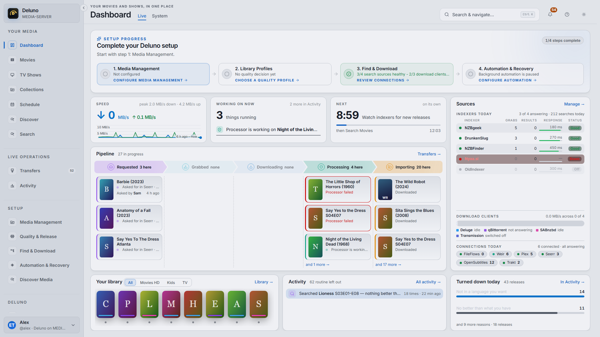
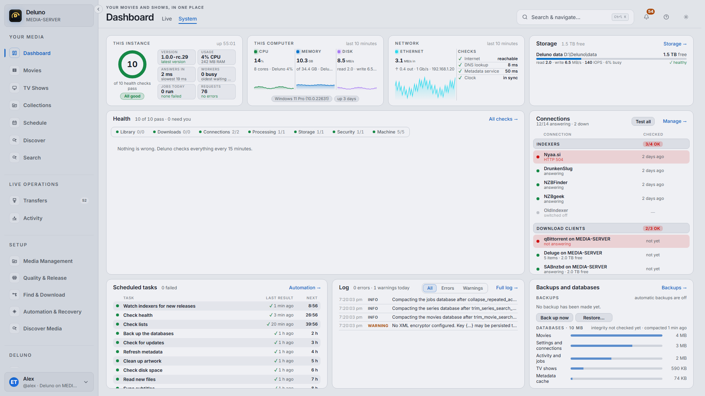
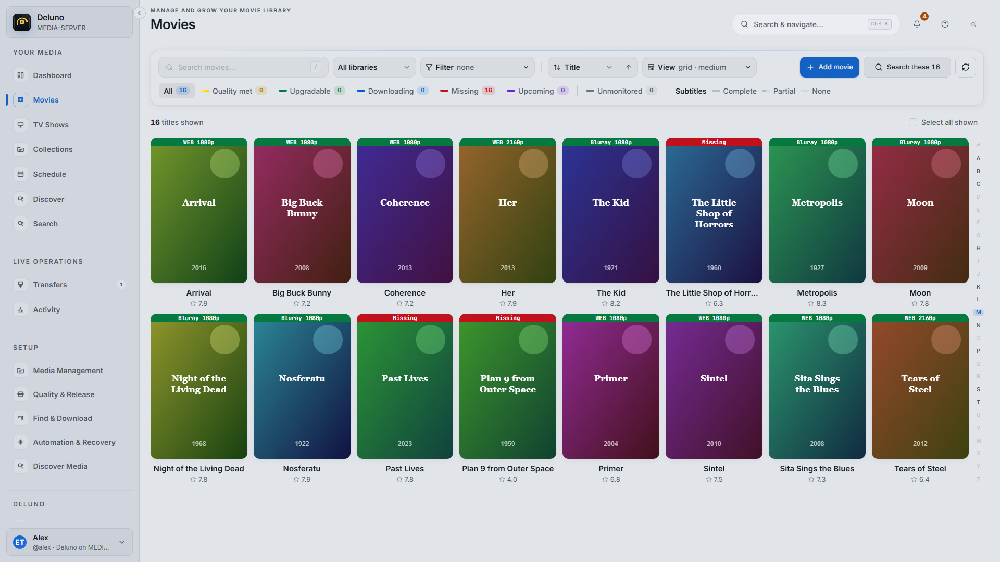
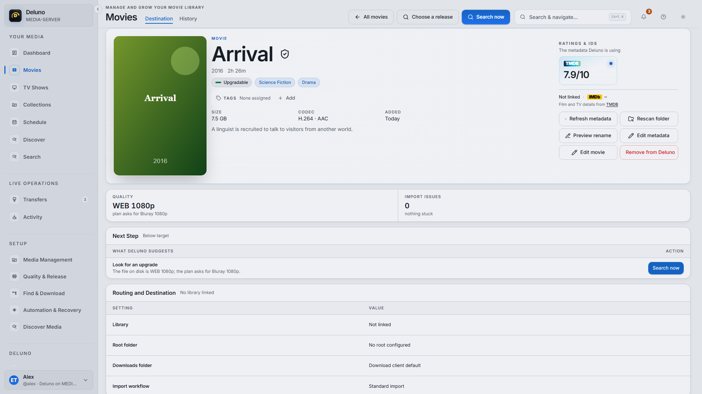
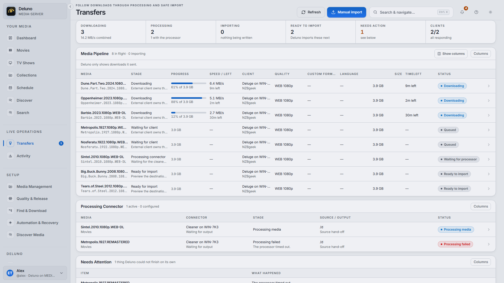
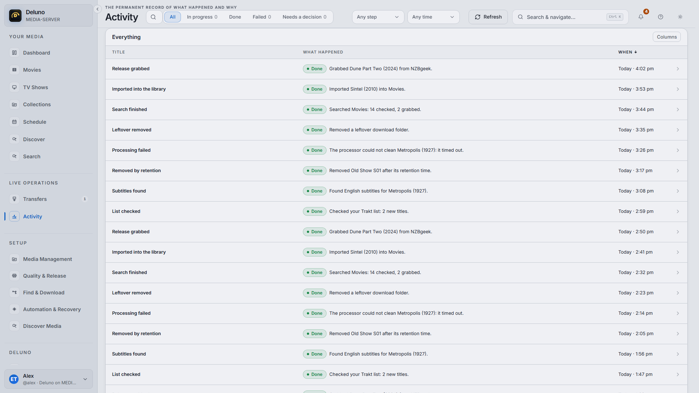
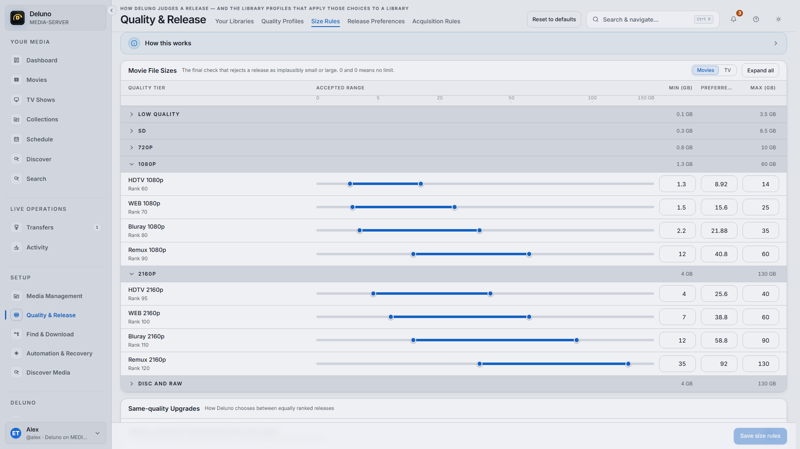

# Deluno

**One app for your movie and TV library, instead of seven.**

Deluno finds releases, sends them to your download client, tidies what arrives, and files it into your library. It then keeps an eye out for the titles you are still missing and the ones that could be better.

It is built to do the job that Radarr, Sonarr, Prowlarr, Huntarr, Cleanuparr, Recyclarr, Upgradarr and the TRaSH Guides do between them, without gathering their settings screens into one bigger settings screen. Where those tools ask you to wire up a pipeline, Deluno asks what you want, decides the rest, and then shows you exactly what it did.

It runs on Windows and in Docker. It is for one person, and your data stays on your machine.

> **Deluno is early.** It is being tested hard, and it is not finished. Expect some
> rough edges, and please do not point it at the only copy of anything you cannot
> replace. Nothing runs on its own until you switch it on, and what Deluno does is
> written to Activity. If something looks wrong, confusing
> or just ugly, [tell us](https://github.com/jampat000/Deluno/issues). That is the
> most useful thing you can do right now, and every report gets read.

 

*The Dashboard: what is happening right now, and the health of the machine*

 

*The Movies library, and one movie's page*

 

*Transfers, and Activity: every search, grab, import and rename, in the order it happened*



*Quality and release choices*

## What it replaces, and why one app is better

If you run the usual stack today, you have one app for movies, one for TV, a third to manage the indexers, a fourth to keep searching for missing items, a fifth to clean up stuck downloads, and a couple of scripts to keep quality settings in step with a guide. Each has its own login, its own idea of a "quality profile", and its own list of things that can quietly stop working. When something goes wrong you are left working out which of them is to blame.

Deluno puts that in one place:

- **It finds things.** Add Torznab, Newznab or RSS sources straight to Deluno. There is no Jackett or Prowlarr in the middle. Deluno asks them itself, respects each site's request limits, and sends each library to the sources you chose for it.
- **It decides what is worth having.** Quality profiles, cutoffs, custom formats, size limits and release preferences, with the TRaSH Guides' thinking built in as choices you can see and change. Deluno explains each decision in plain words, so you never have to reverse-engineer a score.
- **It hands off to your download client.** SABnzbd, NZBGet, qBittorrent, Transmission, Deluge or uTorrent. Your client keeps doing the transfer work it is good at. Deluno owns the searching, sending, watching, importing, naming and recovering.
- **It tidies before it files.** A library can refine before it imports. The finished download goes to a separate tool that cleans it up, and Deluno imports the cleaned result. See [Working with Weir](#working-with-weir).
- **It keeps looking.** It searches again, on a schedule you choose, for what is still missing and for what falls short of your target quality, and it respects the seeding rules of private trackers.
- **It tells you the truth.** The dashboard shows live download progress. Activity records everything Deluno did and why. Health checks ask whether a thing is *usable*, not just whether it answers.

Movies and TV run on separate engines inside, so they never fight over the same download.

## Install on Windows

You need 64-bit Windows. You do not need administrator rights to install Deluno.

1. Download the latest `Setup.exe` from [Releases](https://github.com/jampat000/Deluno/releases). Beside it you will find `SHA256SUMS.txt`, if you want to check the download.
2. Run it. Deluno is not code-signed yet, so Windows SmartScreen may say "Windows protected your PC". Choose **More info**, then **Run anyway**. That warning means the publisher is not verified, not that anything is wrong with the file.
3. Deluno installs for your user account and starts. Its icon appears in the system tray.
4. **Windows asks for permission once.** A prompt asks whether other devices on your network may reach Deluno, which adds a Windows Firewall rule for Deluno's port. Say yes if you want to open Deluno from your phone or another computer. Say no if you only use it on this PC. You can change your mind later: if the rule is missing, right-click the tray icon and choose **Allow other devices on your network**.
5. **A short list of extras follows.** The installer can also install a download client (qBittorrent, SABnzbd, NZBGet, Transmission or Deluge) and [Weir](#working-with-weir). Tick only what you want. Anything already installed is shown greyed out and left alone. Each tool is downloaded from its own project, checked against a published checksum or signature, and installed with its own installer. Deluno does not connect any of them for you; you do that yourself in the setup guide's "Connect the apps you installed" step. If you want to know more, see [what the installer does and does not do](docs/bundled-components-install.md).
6. Open Deluno from the tray icon, or go to [http://localhost:7879](http://localhost:7879) in your browser.

| | |
|--|--|
| Program | `%LocalAppData%\Deluno` |
| Your data (databases, backups, logs) | `%LocalAppData%\DelunoData` |
| Settings file | `%LocalAppData%\Deluno\config\deluno.json` |
| Logs | `%LocalAppData%\DelunoData\logs` (start-up problems from the tray: `%LocalAppData%\Deluno\logs`) |

Your data lives outside the program folder on purpose, so updating the program never touches it.

## Install with Docker

**Linux:** running Deluno directly on Linux (as a systemd service, without Docker) is not supported yet. On Linux, use Docker, as below.

Images are published to GitHub's container registry as `ghcr.io/jampat000/deluno`. Use a version tag such as `1.0.0-rc.28`. Release CI checks each version tag is pullable before it counts as released, but it does not move `latest` for pre-release builds, so `latest` can be older than what you want.

Inside the container, Deluno listens on port `8080` and keeps its own databases, keys and logs under the folder named by `Storage__DataRoot`. The container runs as a normal user, not root. It does not have the `PUID`/`PGID` settings you may know from other images. If you need files owned by your own user, tell Docker who to run as with `user:` (or `--user`), as the examples below do.

### Getting the folders right first

This is the part that most often goes wrong, with any media tool, so decide it before you start.

Deluno and your download client must both see the finished download at the **same path**, and the download folder and the library must be on the **same drive and share**. If they are, Deluno can *hardlink* a finished file into your library instead of copying it: the film appears in the library at once, takes no extra space, and your client can keep seeding the original. If they sit on different drives, or you mount them as two separate volumes, every import turns into a slow, space-hungry copy, or fails.

The usual answer, which the [TRaSH Guides](https://trash-guides.info/) describe, is one data folder on the host that holds everything, mounted at the same place in every container:

```text
/srv/data                      <- on the host
├── downloads
│   ├── torrents
│   └── usenet
└── media
    ├── movies
    └── tv
```

Each container then mounts `/srv/data` as `/data`. Inside the download client, set the save folder to `/data/downloads/torrents` (or `/data/downloads/usenet`). Inside Deluno, point the libraries at `/data/media/movies` and `/data/media/tv`. Because the client and Deluno agree on every path, nothing needs translating.

Deluno's own data goes in a separate `config` folder, since `/data` is now taken by your media.

### docker run

Replace `1000:1000` with the user and group that own `/srv/data` on your server (`id` will tell you), and make sure that user can also write to `/srv/deluno-config`.

```bash
docker run -d \
  --name deluno \
  --user 1000:1000 \
  -p 5099:8080 \
  -e Storage__DataRoot=/config \
  -e TZ=Australia/Sydney \
  -v /srv/deluno-config:/config \
  -v /srv/data:/data \
  --restart unless-stopped \
  ghcr.io/jampat000/deluno:1.0.0-rc.28
```

Set `TZ` to [your own time zone](https://en.wikipedia.org/wiki/List_of_tz_database_time_zones) instead of `Australia/Sydney`, so schedules, the log and Activity use your local time. Then open `http://<server>:5099`, where `<server>` is the name or address of the machine running Docker.

### docker-compose.yml

This one puts a qBittorrent container beside Deluno, with the shared `/data` folder laid out as above. If you already run your own client, keep only the `deluno` part and give your client the same `/srv/data:/data` mount.

```yaml
services:
  deluno:
    image: ghcr.io/jampat000/deluno:1.0.0-rc.28
    container_name: deluno
    user: "1000:1000"
    ports:
      - "5099:8080"
    environment:
      Storage__DataRoot: /config
      TZ: Australia/Sydney  # set your own time zone
    volumes:
      - /srv/deluno-config:/config
      - /srv/data:/data
    restart: unless-stopped

  qbittorrent:
    image: lscr.io/linuxserver/qbittorrent:latest
    container_name: qbittorrent
    environment:
      PUID: 1000
      PGID: 1000
      TZ: Etc/UTC
      WEBUI_PORT: 8081
    ports:
      - "8081:8081"
    volumes:
      - /srv/qbittorrent-config:/config
      - /srv/data:/data
    restart: unless-stopped
```

Start it:

```bash
docker compose up -d
```

Then in qBittorrent set the default save path to `/data/downloads/torrents`, and in Deluno connect qBittorrent at `http://qbittorrent:8081` (containers in the same compose file reach each other by service name).

If you would rather keep Deluno's data inside the container's default `/data` folder, drop `Storage__DataRoot` and mount your data at `/data`. Just keep the download client and Deluno's library paths consistent whichever way you do it.

Some settings only make sense for special setups and are left out here. The repository's [compose.yaml](compose.yaml) shows them, and [Deployment](docs/DEPLOYMENT.md) explains them.

## First run

The first time you open Deluno it asks you to create your account, then walks you through setup: a library, a source to search, and a download client. Each step says what it still needs, and the setup guide will not pretend a step is done when it is not.

**Nothing automatic is on until you say so.** Searching on a schedule, upgrading, cleaning up, keeping to an address list: the guide asks about each with a plain Yes or No, and a fresh install starts with them all off. Anything left off shows up on the dashboard so you do not forget it, and anything that is on writes what it did to Activity.

## Reaching Deluno from another computer, safely

Deluno listens only on the computer it runs on until you allow more, because a fresh install has no password yet and nothing else on your network should be able to reach it.

- **Windows (the installed app):** answer yes to the firewall prompt at install time. If you said no and want to change it, right-click the tray icon and choose **Allow other devices on your network**.
- **Docker:** the image already sets `Server__AllowLan=true`, so `-p 5099:8080` makes Deluno available on every network interface of the machine. To keep it to the machine itself, publish it as `-p 127.0.0.1:5099:8080` (in compose, `"127.0.0.1:5099:8080"`) and put a reverse proxy in front.
- **Running `Deluno.Host` yourself:** set `Server:AllowLan` to `true` in `appsettings.json` (`"Server": { "AllowLan": true }`), or start it with `--Server:AllowLan=true`. Leave it out and Deluno answers on `localhost` only.

Deluno has one account protected by your password, so treat it like the admin page of a router. Choose a long, unique password. Do not forward its port from your router to the internet.

If you want to reach it away from home, the safest options are a VPN you already trust (WireGuard, Tailscale and the like), or a reverse proxy that serves it over HTTPS. Behind a proxy, turn on **Allowed Hosts** in **System → Security**, so Deluno answers only on the addresses you actually use. [Allowed Hosts](docs/security-allowed-hosts.md) explains how it works and how to get back in if you lock yourself out.

## Working with Weir

[Weir](https://github.com/jampat000/Weir) is a separate, companion project that does the clean-up step before Deluno imports a download. It is how Deluno's *refine before import* works:

1. Your download client finishes a download.
2. Weir cleans up the output.
3. Deluno imports the cleaned result through the same checks as any other import.

Deluno and Weir are independent. Each works without the other, and neither contains code for the other. The Windows installer's extras list offers Weir if you want it; otherwise follow Weir's own instructions, then connect it in Deluno with **Connect processor** on the processing settings page. If you are happy with files exactly as downloaded, you do not need it.

## Updating, backing up and uninstalling

**Windows.** Updates appear in **System → Updates** and install in the background. Before a bigger update, make a backup under **System → Backups** and download it somewhere else. The [backup and restore runbook](docs/backup-restore-runbook.md) covers restoring, including onto a new computer. To uninstall, use **Settings → Apps → Installed apps** in Windows. The download clients and Weir you installed through the extras list are separate programs and are not removed with Deluno. They are uninstalled the same way, one by one. Your data folder is not part of the program folder; delete `%LocalAppData%\DelunoData` yourself if you want it gone.

Backups also hold Deluno's keys (which unlock your saved passwords and API keys), but only if you set a **backup password** in **System → Backups**. The keys are locked with that password, and a restore asks for it. Without a password the keys are left out, and after a restore you enter your saved passwords and API keys again.

**Docker.** There is no updater inside the container. Make a backup under **System → Backups**, change the version tag in your compose file, and run:

```bash
docker compose pull deluno
docker compose up -d
```

Keep the same `/config` mount (or `/data`, if that is where Deluno's data lives) so your settings carry over. Databases only move forward, so to go back to an older version you must also restore a backup taken before the update. To uninstall, run `docker compose down` and delete the image. Your folders stay where they are until you remove them.

Moving from an older 0.x install? There is an [upgrade guide](docs/upgrade-guide-0x-to-1x.md).

## Getting help

- **Something broke, looks wrong, or is confusing:** open an [issue](https://github.com/jampat000/Deluno/issues). Say what you did, what you expected and what happened. A line from the log (see the paths above, or `docker logs deluno`) helps a great deal. Leave out API keys and passwords.
- **A security problem:** please do not post details in a public issue. Message the maintainer privately through GitHub instead.
- **What changed in each version:** [release notes](RELEASE_NOTES.md). They are also shown inside the app, under System → Updates.
- **Stuck:** [Troubleshooting](docs/TROUBLESHOOTING.md) covers the usual first checks.

## More documentation

- [Architecture](./docs/ARCHITECTURE.md)
- [Deployment](./docs/DEPLOYMENT.md)
- [Packaging and releases](./docs/packaging.md)
- [Backup and restore runbook](./docs/backup-restore-runbook.md)
- [Supported reference media flow](./docs/REFERENCE_MEDIA_FLOW.md)
- [Troubleshooting](./docs/TROUBLESHOOTING.md)
- [0.x to 1.x upgrade guide](./docs/upgrade-guide-0x-to-1x.md)
- [Product north star](./docs/PRODUCT_NORTH_STAR.md)
- [Media automation terminology](./docs/MEDIA_AUTOMATION_TERMINOLOGY.md)

## Privacy

Deluno has no analytics and sends no usage reports. It talks only to the indexers, download clients and metadata services you set up, and to its update feed (by default the GitHub releases for this project). Saved passwords and API keys are stored encrypted and are never sent back out through the API.

## Development

For people building Deluno from source. You need the [.NET 10 SDK](https://dotnet.microsoft.com/download) and [Node.js 20+](https://nodejs.org).

```bash
npm install
npm run dev:web        # front end on :5173
```

In a second terminal:

```bash
dotnet run --project src/Deluno.Host   # API on :5099
```

Before pushing, run the whole gate. It builds Release once, then runs the backend tests, the repository checks and the web tests side by side:

```bash
npm run gate
```

How it is built: a .NET 10 backend and a React 19 front end, with the backend serving the front end and running all the background work. It uses SQLite, with a separate database for each area. ffmpeg is used to inspect media; it is included in the Docker image and the Windows installer, and a run from source needs it on your `PATH`.

The real-world media-flow fixtures use temporary databases and folders and never touch a configured library:

```powershell
.\scripts\test-real-world-flows.ps1             # fast focused flows
.\scripts\test-real-world-flows.ps1 -FullSuite  # plus the full release suite
```

Contributors working with an AI assistant should start at [AGENTS.md](AGENTS.md).

## Licence

Deluno is free software under the [GNU Affero General Public License v3.0](LICENSE) (AGPL-3.0). Copyright (C) 2026 James Paton. You can use it, change it and share it, and if you share a changed version, or run one for other people over a network, you must share your changes under the same licence.

## Security

Found a security problem? Please report it privately, not in a public issue. [SECURITY.md](SECURITY.md) says how.